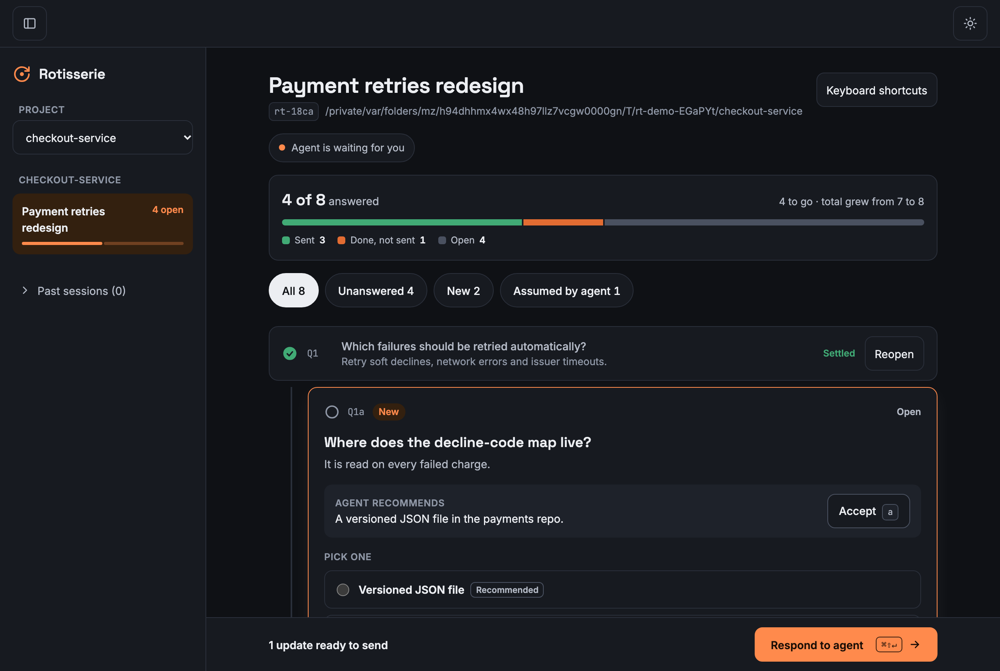

# Rotisserie

[](https://github.com/dlebed/rotisserie/actions/workflows/ci.yml)

Rotisserie is a Claude Code plugin that moves "grill me" interviews out of the terminal and into a web page.

The `grill-me` skills from `mattpocock-skills` interview you in rounds of numbered questions. A round can hold 20 to 30 questions, and answers spawn follow-ups (Q1a, Q1b). In a terminal it gets hard to see which ones are still unanswered. With Rotisserie the agent posts the questions to a live page on your machine. You answer in any order, at your own pace, and press Respond to send a batch. While you think, the agent waits at zero token cost.



What you get:

- A page that shows what is answered, open, new, sent, or assumed by the agent, with follow-ups nested under their parent.
- Answers you can keep editing until you send them, and drafts that autosave.
- Skip (the agent investigates and decides, marked "assumed by agent" with its reason), Invalid (the agent must retract or re-ask, visibly), and Later.
- Partial rounds: send 5 answers out of 10 and the other 5 stay yours. The agent cannot decide a question you have not answered; the server refuses it.
- Sessions stored as files in your project, so they survive restarts and agents can search them later.
- A page that keeps working if the agent's session closes: actions queue in the browser and are sent when the agent is back.
- Light and dark themes, and keyboard control of a whole session.

## Requirements

- Claude Code.
- Node.js 20 or later on the `PATH`. That is all: the plugin ships a prebuilt bundle in `dist/`, with no install step and no native dependencies.
- The `mattpocock-skills` plugin. Rotisserie does not copy its rules; the Rotisserie skills load `mattpocock-skills:grilling` (and `mattpocock-skills:domain-modeling` for `grill-with-docs`) and only change how questions are delivered.

## Install

Inside Claude Code:

```
/plugin marketplace add dlebed/rotisserie
/plugin install rotisserie@rotisserie-marketplace
```

From a shell:

```
claude plugin marketplace add dlebed/rotisserie
claude plugin install rotisserie@rotisserie-marketplace
```

The marketplace entry declares `mattpocock-skills` from `claude-plugins-official` as a dependency, so installing through the marketplace should pull it in. If it is missing (for example when you load the plugin straight from a folder), install it yourself:

```
/plugin install mattpocock-skills@claude-plugins-official
```

The skills check for it at run time and stop with this same command if it is absent.

To try the plugin from a checkout without installing it: `claude --plugin-dir .` from the repository root. `claude plugin validate .` checks the manifests.

## Use

Run one of these in a project:

- `/rotisserie:grill <topic>`: a grill-me interview.
- `/rotisserie:grill-with-docs <topic>`: the same, plus the glossary and decision records from `domain-modeling`.

The agent starts a session, prints a link, and (unless disabled) opens it in your browser. Then:

1. Answer questions in the page. Each question has the agent's recommendation; "Accept" takes it. You can pick options, write your own answer, and add a note.
2. Press Done on a question to fold it. Nothing is sent yet.
3. Press Respond to send what you have marked Done as one batch. You do not have to answer everything first: unanswered questions stay open and the agent waits for them. The agent wakes up, resolves what you answered, and posts follow-ups, which appear under their parent without moving anything you are looking at.
4. When no questions remain, the agent posts a summary. "Confirm shared understanding" ends the session. "Not yet" needs a note and reopens it. The agent acts only after you confirm.

How the waiting works: after posting, the agent starts `node dist/cli.js wait <id>` as a background shell task and ends its turn. The command checks the session file about once a second and exits when you send a batch, which wakes the agent. It reads files only. Nothing is polled by the model, so waiting costs no tokens. If you type in the terminal while it waits, the agent also fetches your updates.

If you close Claude Code and come back later, the skill tells the agent to fetch pending updates first, because you may have answered while it was closed.

## Keyboard

Keys without Ctrl/Cmd or Alt are ignored while you are typing in a text field.

| Key | Action |
|---|---|
| Ctrl/Cmd+Enter | Done: fold and focus the next open question |
| Ctrl/Cmd+Shift+Enter | Respond |
| Alt+Down / Alt+Up | Next / previous question (works while typing) |
| J / K | Next / previous question |
| N | Next new question |
| 1 to 9 | Pick or toggle that option |
| A | Accept the recommendation |
| S, I, L | Skip, Invalid, Later |
| E or Enter | Unfold the focused question |
| Esc | Leave the text field, keep the question focused |
| ? | Show the shortcut list |

With no question focused, the keys act on the unfolded one.

### Who decides what

| Your response | What the agent may do |
|---|---|
| Answer | Record the decision your answer gives, or ask a follow-up. |
| Skip | Decide it itself, marked "assumed by agent" with a reason. You can reopen it, also from the summary. |
| Invalid | Retract the question with a reason, post a corrected one, or point to where you already decided it. |
| Nothing yet | Wait. It may retract the question, with a reason, only if another answer made it irrelevant. |

These rules are enforced by the MCP server, not only requested in the skill text.

## Configuration

All settings are environment variables, read by the MCP server process. Set them in the environment Claude Code starts with.

| Variable | Default | Meaning |
|---|---|---|
| `ROTISSERIE_HOST` | `127.0.0.1` | Address the web server binds to. |
| `ROTISSERIE_PORT` | `4783` | Port of the web server. |
| `ROTISSERIE_HOME` | `~/.rotisserie` | Where the project registry and the URL token live. |
| `ROTISSERIE_NO_OPEN` | unset | When set to any non-empty value, the browser is not opened. The link is still printed. |

### Security model

- The server binds to `127.0.0.1` by default, so only your machine can reach it.
- A random token, stored in `ROTISSERIE_HOME`, is part of the link and is required on every API request. A request without it gets a 401.
- Setting `ROTISSERIE_HOST` to a non-loopback address (for example `0.0.0.0`) exposes the page to the network. The token is then the only protection, and anyone with the link can read and answer your sessions. Prefer an SSH tunnel for remote use.
- The page makes no request to any other host. Fonts, scripts and styles are served from the plugin.
- Summaries are agent-written HTML. They are shown in a sandboxed frame with scripts and external requests blocked.

### One server, many projects

One web server on one port serves all projects and all Claude Code instances. The first MCP process to start binds the port. The others retry about once a second and one takes over within a couple of seconds if the host exits. The page is unavailable only while no Claude Code instance is running. State is on disk, so nothing is lost when the host changes.

## SSH and WSL

Working over SSH: the page runs on the remote machine's loopback. Forward the port and open the link on your laptop:

```
ssh -L 4783:127.0.0.1:4783 user@remote-host
```

When Rotisserie detects an SSH session it prints a ready-made `ssh -L` command with the right port. Use the link as printed (it says `localhost`).

WSL: the browser is opened through the Windows side (`cmd.exe /c start`). Opening can fail in some setups; the link is always printed, so paste it into a Windows browser. Windows browsers normally reach WSL2 servers on `localhost`.

Sandbox note: Claude Code's Bash sandbox applies to Bash commands only. The MCP server runs outside it, so it can bind the port and open the browser. The `wait` command is run through Bash and only reads files, so it works in the default sandbox with no extra settings.

## Where sessions are stored

Each session is an append-only event log, one JSON event per line, at `.rotisserie/sessions/<id>.jsonl` in the project. Each log starts with a format version; a newer log than the installed Rotisserie understands is not rendered ("update Rotisserie to view this session"). Drafts are kept next to the logs.

You choose whether to share them:

- Commit `.rotisserie/` to keep interview history with the code, searchable by anyone who clones the repository.
- Or add `.rotisserie/` to `.gitignore` to keep sessions private to your machine.

The registry of projects and the token are in `~/.rotisserie/` (or `ROTISSERIE_HOME`).

## MCP tools

The agent uses 11 tools from the `rotisserie` MCP server: `start_session`, `post_questions`, `get_updates`, `resolve_question`, `retract_question`, `set_status`, `post_summary`, `add_note`, `list_sessions`, `get_session`, `search_sessions`. Past sessions can be searched by keyword or regular expression.

## Portability

The MCP server is a standard stdio server and the skills are plain `SKILL.md` files. Only the plugin packaging and the background-wait mechanism are specific to Claude Code. A port to Codex or Copilot needs new packaging and that harness's equivalent of a background task.

## Development

```
npm ci
npm run typecheck
npm run build      # writes dist/ (bundles the MCP server, the wait command and the page)
npm test           # unit tests plus the end-to-end smoke test, which needs dist/
```

`dist/` is committed because the plugin runs from it. After changing source, run `npm run build` and commit the result; CI fails if the committed `dist/` is stale. The smoke test binds a local port, so it does not run in a sandbox that forbids that.

## License

MIT. See `LICENSE`.
